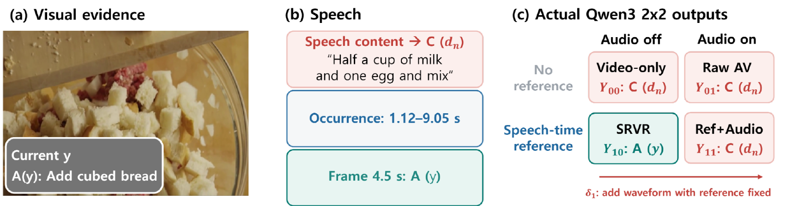
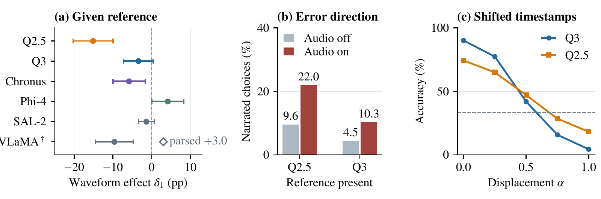

# What Does Waveform Audio Add Once a Speech-Time Reference Is Given? A Factorial Study of Cross-Modal Temporal Binding

> [!IMPORTANT]
> **Submitted to ICASSP 2027 — under review.** No acceptance or publication is claimed.

**[Project Page](https://owinhun.github.io/REPO_NAME/)** · **[Manuscript PDF]((https://github.com/owinhun/SRVR/blob/main/paper.pdf))**

**Seunghun Oh\* · Jaehong Myung\* · Unsang Park†**  
\* Equal contribution · † Corresponding author  
Department of Artificial Intelligence / Department of Computer Science and Engineering, Sogang University

This repository presents **a controlled factorial study of cross-modal temporal binding** in audio–visual language models. We ask a specific question: **once a model is told when speech occurs, what additional effect does giving it the waveform have?** The study diagnoses reference and waveform contributions on matched questions rather than proposing a new model or claiming that removing audio is generally beneficial.

## Overview

Narration does not always describe what is happening in the video at the same moment. A waveform contains both a cue to **when speech occurs** and linguistic/acoustic information that can pull an answer toward an action mentioned in speech rather than the visually concurrent action. Removing audio without separately providing speech timing mixes these effects.

We therefore cross **speech-time reference availability** and **waveform audio access** on the same question:

| Condition | Speech-time reference | Waveform audio | Purpose |
| --- | --- | --- | --- |
| **Video-only** (Y₀₀) | No | No | Visual baseline without supplied timing |
| **Raw AV** (Y₀₁) | No | Yes | Usual audio–visual input |
| **Speech-Referenced Visual Re-query (SRVR)** (Y₁₀) | Yes | No | Visual answer with speech timing supplied |
| **Reference + Audio** (Y₁₁) | Yes | Yes | Waveform contribution with reference held fixed |

The main comparison is the **reference-fixed waveform effect**, **δ₁ = Y₁₁ − Y₁₀**. A negative value means the measured accuracy was lower with audio present under that reference condition. The separate **reference gain with audio**, **τ₁ = Y₁₁ − Y₀₁**, captures what the reference adds when audio remains available.



*Figure 1 is an illustrative item; its individual predictions are not aggregate model-level evidence.*

## Experimental Design

1. **Set aside evaluation questions.** Split 339 official SVHalluc Cross-Modal Temporal Binding (CMTB) items by source video into **48 development** and **291 evaluation** questions; use only the development set for prompt and speech-detection settings.
2. **Derive speech-time references.** Detect speech activity with Silero VAD without using question text, answer options, or labels. Numeric-reference models receive start/end times together with visual-answering instructions; two models use a localized media interval instead. These are different reference interventions and are not pooled into one common treatment.
3. **Evaluate a matched 2×2 design.** Hold the question, model, and decoding setup fixed across video-only, raw AV, SRVR, and reference+audio inputs. Use six frozen model configurations with model-specific media handling.
4. **Audit where answers come from.** Shift reference timestamps, black out video, rotate options, reverse speech audio, and compare transcript probes; inspect errors directed toward narrated versus visually current actions.
5. **Test external scope.** Use selected-speech settings on **CrossTask (93 questions)** and **COIN (85 questions)**, reporting paired outcomes and uncertainty without treating them as equivalent to CMTB.

### Evaluated model configurations

Qwen2.5-Omni-7B, Qwen3-Omni-30B-A3B-Instruct, ChronusOmni, Phi-4-multimodal, Video-SALMONN-2, and VideoLLaMA2.1-7B-AV.

## Key Findings

| Model | Reference + audio (Y₁₁) | SRVR / audio off (Y₁₀) | δ₁ (percentage points) |
| --- | ---: | ---: | ---: |
| Qwen2.5-Omni | 59.1% | 74.2% | **−15.1** |
| Qwen3-Omni | 86.6% | 90.0% | −3.4 (inconclusive) |
| ChronusOmni | 80.8% | 86.6% | −5.8 (correction-sensitive) |
| Phi-4-multimodal | 61.5% | 57.4% | +4.1 (inconclusive) |
| Video-SALMONN-2 | 80.1% | 81.4% | −1.4 (inconclusive) |
| VideoLLaMA2.1 | 67.7% | 77.3% | −9.6 (failure-sensitive) |

- **References improve the audio-on point estimates.** Gains range from **+6.2 to +26.8 pp** for the four numeric-reference models and **+26.5 to +34.4 pp** for the two localized-reference models. The intervention classes differ, so these ranges should not be pooled as one effect.
- **Qwen2.5 shows a robust reference-fixed waveform loss.** Its main effect is **−15.1 pp** and the negative direction persists in bare-timestamp and localized-reference controls.
- **Smaller and model-dependent effects remain uncertain.** The Qwen3 main-prompt effect is inconclusive; Chronus changes under broader multiplicity corrections; the VideoLLaMA2.1 estimate changes sign under an all-four-parsed sensitivity analysis.
- **Time-specific visual evidence matters.** Shifting timestamps away from speech time sharply reduces audio-off accuracy, supporting reliance on the referenced visual interval in the tested controls.
- **No general audio-removal benefit was demonstrated externally.** On selected-speech CrossTask and COIN inputs, all exact paired tests are inconclusive and their conservative intervals include zero.



*Figure 2 summarizes the reference-fixed waveform contrast, confirmed narrated-choice errors, and shifted-timestamp controls.*

**Scope:** A negative interaction is not the same as proving the waveform itself is harmful. Numeric timestamp references also include visual-use instructions, the task is a targeted stress test, and results depend on model-specific input handling and error sensitivity. Refer to the manuscript for exact comparison families, adjusted tests, and limitations.

## Manuscript and Reproduction

**[Read the manuscript](./paper.pdf)** for the full protocol, tables, tests, control conditions, and limits.

The supplied research package contains the LaTeX manuscript, bibliography, style files, tables, and paper figures. **A portable experiment environment, datasets, model checkpoints, and validated end-to-end reproduction commands are not included in this public-page package.** Do not interpret the presence of a manuscript PDF as a runnable release. Installation instructions will be documented when runnable artifacts have been prepared and checked.

## Release Status

- [x] Manuscript and project figures prepared
- [x] Project Page source prepared
- [ ] Project Page activated on GitHub Pages
- [ ] Research code and dependencies released with a validated run guide
- [ ] Dataset and model-access instructions documented
- [ ] End-to-end reproduction commands validated

## Acknowledgements

This work was supported by the Institute of Information & Communications Technology Planning & Evaluation (IITP) grant funded by the Korea government (MSIT) (No. RS-2024-00438027, Development of an intelligent security and risk response system based on multi-modal data integration analysis), and by the IITP under the Artificial Intelligence Innovation Human Resources Development grant (IITP-RS-2026-25547954) funded by the Korea government (MSIT).

## Contact

For inquiries about this research, open an issue in this repository.

## Citation

The manuscript is **under review**. The entry below is a provisional manuscript citation, **not** a published conference-proceedings citation.

```bibtex
@unpublished{oh2026waveform,
  title  = {What Does Waveform Audio Add Once a Speech-Time Reference Is Given? A Factorial Study of Cross-Modal Temporal Binding},
  author = {Oh, Seunghun and Myung, Jaehong and Park, Unsang},
  year   = {2026},
  note   = {Manuscript submitted to ICASSP 2027; under review}
}
```
